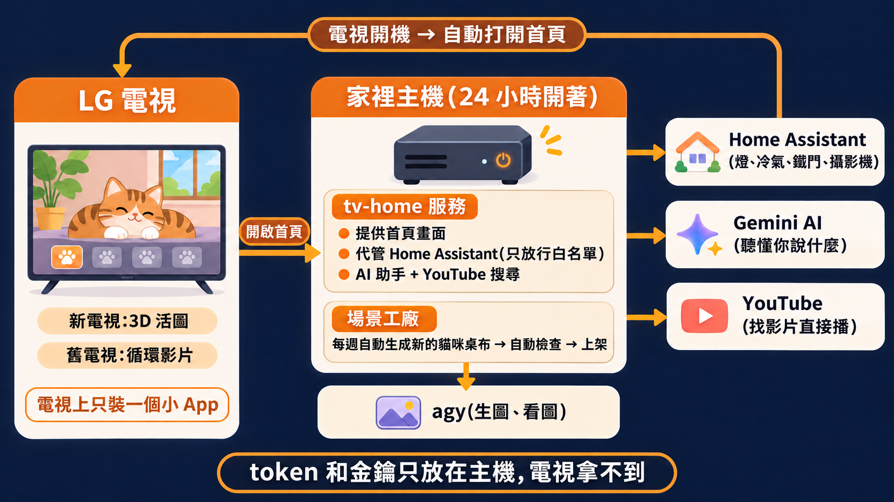

# LG_CleanTV — 貓咪首頁(LG webOS 電視的自訂首頁)

把 LG 電視開機後的第一個畫面換成一張「會動的貓」:背景是一張由程式讓它活起來的插畫/照片(活圖),上面疊著時鐘、天氣、
家裡的狀態與控制(透過 Home Assistant)、常用 App,以及一個可以用講的或打字的 AI 助手。電視上只裝一個很小的 webOS App,
真正的介面放在家裡一台一直開著的主機上(Docker 容器「bridge」),所以 Home Assistant 的 token、Gemini 金鑰都不會進到電視。
主機上還可以跑一個「場景工廠」,每週自動用 agy(Google Antigravity CLI)生出新的貓場景、自動檢查後上架。

> 效果圖與影片之後補上。

## 功能
- **活圖貓背景**:一張 16:9 的圖 + 預先烘焙的網格權重,WebGL2 每格約 1 ms。貓的眼珠會**看著目前選到的 App 磚**,耳朵抖動、
  尾巴擺動、呼吸、鬍鬚輕擺;依時間調色,晚上瞳孔放大,深夜(23–6 點)變成想睡的樣子,煙霧警報時警戒。臉整塊剛性移動、不眨眼。
- **多種場景**:動畫風/寫實風的虎斑與黑貓、玩毛線球、睡覺、耳機女孩(早晨/雨夜,雨痕與散景閃爍)。
- **換桌布**:依時段排程或每天輪換;女孩場景**隨機出現**(依日期種子,一天最多幾次);設定頁有縮圖、「固定這個場景」;
  **遙控器色鍵**:紅 = 上一個、綠 = 一直固定(再按取消)、黃 = 回自動、藍 = 下一個。換場景時 1.4 秒交叉淡入。
- **Home Assistant 狀態與控制**(白名單):天氣、室內溫濕度、有人/煙霧、掃地機、燈、冷氣(開關 + 溫度);
  **車庫門要二次確認**,AI 助手對車庫門只能查不能動。
- **攝影機**:電池相機只在按下時拍一張(有頻率限制);**睡著的電池 Tapo 會先被喚醒**——bridge 對它的 LAN 位址每秒試著連線一次
  (最多 15 秒),相機醒來後再向 HA 要畫面。插電相機可開「即時畫面」約 1.5 秒刷新。
- **AI 助手**:Gemini function calling(查狀態、控制白名單內的裝置、**搜尋 YouTube 並直接播放**);沒有金鑰或免費額度用完時
  自動退回內建的簡單規則(開關燈、冷氣幾度、車庫門狀態、「播放 X」)。
- **App 列**:YouTube、瀏覽器開 HA、電視、HDMI 1–4(合成一格、焦點時展開)、Netflix 等;**「壁爐」磚 = `ytsearch_play`**:
  主機用 YouTube 搜尋挑一部 ≥ 60 分鐘的影片(一天換一次)直接播,只改設定就能加更多這種磚。
- **開機自動跳首頁**(HA 自動化,被 HDMI 裝置喚醒時不跳)與 **Developer Mode 自動續期**(避免 1000 小時到期 App 被刪)。
- **舊電視也能用**:webOS 4.x(Chrome 53)自動改載入 ES5 版本,背景改播預錄的無縫循環影片。
- **主機端場景工廠**:cron + Docker + agy,自動生圖 → 標地標 → 綁骨架 → 幾何 QA → AI 審查 → 上架;有停用開關與磁碟預算。

## 架構



<details><summary>文字版架構(細節)</summary>


```
   ┌──────────────── LG 電視 ────────────────┐
   │ webOS App(.ipk,Developer Mode 安裝)    │   開機頁只做一件事:探測 bridge,
   │  lg/app/index.html ──導向──▶ http://<主機>:8790/?tv=1   連不到就顯示離線畫面(不黑屏)
   │ 首頁(web/,由主機提供)                  │
   │  新電視:ES module + three.js + 活圖      │
   │  舊電視:web/legacy/app.legacy.js + 影片   │
   └──────────────┬───────────────────────────┘
                  │ HTTP / SSE(只限白名單 IP 能控制)
   ┌──────────────▼──────── 家裡主機(一直開著)────────────────────────────┐
   │ Docker「tv-home」= bridge/server.py(aiohttp, --net=host, :8790)       │
   │  ├ 提供 web/、cats/、vendor/ 靜態檔                                    │
   │  ├ 代理 HA:REST + websocket,只放行 config.json 白名單 ──▶ Home Assistant
   │  ├ /api/assist ──▶ Gemini API(function calling)                     │
   │  ├ YouTube 搜尋(抓 youtube.com/results,不用 API key)──▶ YouTube      │
   │  └ /api/scenes/factory/run 只寫 factory-data/inbox/request-*.json      │
   │                                                                        │
   │ root cron ──▶ factory/run.sh ──▶ Docker「tvhome-factory」(--rm,限 CPU/記憶體)
   │                 factory.py:agy 生圖 + 視覺 → rigbuild → prep_scene → warpqa → 審查
   │                 成品寫到 cats/gen-live/<id>/ + scenes.json(bridge 下次載入就看得到)│
   └────────────────────────────────────────────────────────────────────────┘
   HA 自動化:電視 off→on ⇒ webostv.command 開本 App;停在首頁 20 秒 ⇒ 每 6 天續期 Developer Mode
```

</details>

更多設計理由見 `DECISION.md`,開發筆記(API、設定欄位、量測)見 `docs/DEVNOTES.md`,
貓場景契約見 `cats/README.md`,活圖引擎見 `cats/live/NOTES.md`,場景工廠見 `factory/README.md`。

## 支援的電視

| | 新電視(主要目標) | 舊電視(Legacy) |
|---|---|---|
| 驗證過的平台 | **webOS 26**(Chromium 132),PowerVR GPU,1920×1080,dpr 1 | **webOS 4.4**(2018 機種,Chrome 53),4K 面板(頁面 1920×1080 @ dpr 2) |
| 載入的程式 | `web/app.js`(ES module) | `web/legacy/app.legacy.js`(esbuild 降到 chrome53 的單一 IIFE)+ `legacy.css` |
| 背景 | WebGL2 活圖,**60 fps** | 預錄的 1080p 30 fps 循環影片(MediaSource 無縫循環;原生 `<video loop>` 在 4.4 每圈卡 1.5 秒) |
| 貓看 App / 貓撲圖示 | 有 | **沒有**(影片是烘焙好的,眼睛自己亂看) |
| 介面 | 完整 | 同樣的功能,但沒有毛玻璃、大陰影、磚的動畫(導覽約 53 fps) |
| 自動生成的場景 | 有 | 只顯示靜態圖(除非你另外錄影片) |

`web/index.html` 自動判斷(`'noModule' in script` 且有 `WebGL2RenderingContext` → 新版,否則 legacy);可用 `?legacy=1` / `?legacy=0` 強制。
其他 webOS 版本沒測過:webOS 22–25 應該走新版(Chromium 94–120),但 dpr、效能、ACG 行為可能不同。

## 安裝步驟

需要:LG 電視(和主機同一個區網,建議有線並在路由器固定 IP)、一台一直開著的 Linux 主機(有 Docker;可以就是跑 HA 的那台)、
Home Assistant、一台電腦(Python 3.10+,Node 18+,Chrome;錄舊電視影片才需要 ffmpeg)。

### 1. 開啟電視的 Developer Mode
1. 到 [LG webOS TV Developer](https://webostv.developer.lge.com/) 註冊帳號。
2. 電視的 LG Content Store 安裝「**Developer Mode**」App,用該帳號登入,打開 **Dev Mode Status**(電視會重開)。
3. 再進 Developer Mode App,打開 **Key Server**。畫面上會顯示電視 IP 與 **Passphrase**(6 碼)。
   Passphrase 只放在環境變數,不要寫進任何檔案。
4. 取得私鑰(放在 git 忽略的 `lg/.devkey/`):
   ```bash
   mkdir -p lg/.devkey
   curl -o lg/.devkey/webos_rsa http://<電視IP>:9991/webos_rsa
   ```

### 2. 打包並安裝電視 App
```bash
pip install paramiko
python lg/build.py --bridge http://<主機IP>:8790 --version 0.1.0     # 或 export TVHOME_BRIDGE=http://<主機IP>:8790
#   → build/lg/com.lgcleantv.home_0.1.0_all.ipk
python lg/build.py --no-acg --version 0.1.1                           # 舊電視 / 不宣告 requiredACG 的版本
python lg/build.py --list build/lg/com.lgcleantv.home_0.1.0_all.ipk   # 看包了什麼

export TV_IP=<電視IP> TV_PASSPHRASE=<畫面上的 Passphrase>
python lg/tvssh.py install build/lg/com.lgcleantv.home_0.1.0_all.ipk
python lg/tvssh.py launch com.lgcleantv.home
```
- App id 在 `lg/app/appinfo.json`(和 `lg/appinfo.noacg.json`),想改就兩個一起改,HA 自動化也要跟著改。
- bridge 的網址烘焙在 App 裡;**只有主機 IP 改了才需要重新打包安裝**,介面更新只要更新主機上的檔案。
- 也可以用 LG 官方的 `ares-install` 或 webOS Dev Manager 安裝同一個 .ipk。

### 3. 在主機上部署 bridge
```bash
git clone <this repo> /opt/tv-home && cd /opt/tv-home
cp bridge/.env.example bridge/.env && chmod 600 bridge/.env     # 填 HA_URL、HA_TOKEN(HA 長期存取權杖)、TV_IP、GEMINI_API_KEY(選配)
cp bridge/config.example.json bridge/config.json                # 改成你家的實體 id、IP、場景、App
sudo sh bridge/run.sh                                           # build + 啟動容器 tv-home(--net=host,port 8790)
```
- `config.json` 重點:`tv_ip` / `allow_call_from`(只有這些 IP 能控制,其他只能看)、`ui`(哪個實體放在哪個位置)、
  `entities`(白名單:允許的服務、`confirm: true` = 要二次確認)、`cameras`(電池相機 `battery: true`,要喚醒就加
  `wake_host: "<相機IP>:<任一 port>"`)、`apps`、`scenes` / `wallpaper_schedule`、`assistant.deny_entities`。欄位說明見 `docs/DEVNOTES.md`。
- 先在電腦上用模擬模式試(不連 HA):
  ```bash
  pip install -r bridge/requirements.txt
  python bridge/server.py --mock          # http://127.0.0.1:8790/  (沒有 config.json 時自動用 config.example.json)
  ```
  桌面瀏覽器:方向鍵 / Enter / Esc(= 電視返回鍵)。`MOCK_SMOKE=1` 模擬煙霧警報,`MOCK_CAM_FAIL=1` 模擬相機睡著。
- 更新介面:把 `web/`、`cats/` 的檔案更新到主機(容器是唯讀掛載),電視重開 App 即可;改 `bridge/` 才要再跑 `bridge/run.sh`。

### 4. Home Assistant
1. 安裝官方 **LG webOS TV**(`webostv`)整合並在電視上按「允許」配對。
2. 建一個「切換」小幫手當總開關(例如 `input_boolean.tv_home_autolaunch`),**預設關**,一切測好再打開。
3. 把 `ha/automations.example.yaml` 的兩個自動化(開機跳首頁、Developer Mode 自動續期)依你家的實體 id 改好後加進 HA。
   開 App 一律用 `webostv.command` 的 `system.launcher/launch`(見下方「踩過的坑」)。

### 5. 舊電視(webOS 4.x):legacy bundle 與循環影片
```bash
npm install                       # 只裝 esbuild(devDependency)
node dev/build_legacy.mjs         # web/ 或 web/legacy/ 的 JS 改過後都要重建;--check 檢查是否過期
node dev/record_loop.mjs          # 每個場景錄一段無縫循環影片(需要 Chrome + ffmpeg),約 3 分鐘一個
#   → cats/video/<scene>.mp4 + .jpg + index.json(repo 已附 8 個場景的影片,共約 53 MB;新增場景時再錄)
```
`web/legacy/app.legacy.js` 是產生的檔案,為了讓 clone 下來就能用而放進 git;不要手改。
Chrome 不在預設位置時設 `CHROME=<chrome 執行檔路徑>`(`dev/shot.mjs`、`dev/homeshot.mjs`、`dev/record_loop.mjs` 都吃)。

### 6. 自己做貓場景(手動)
本 repo **不含任何圖片/貓的素材**,第一次要自己做。沒有 pack 的場景會被跳過,最後退回純程式產生的背景(`cats/_example/`;
`cats/pixar/`、`cats/real/` 是完全用程式畫的 3D 貓,也不需要素材,可在 `config.json` 的 `styles` 加入):
1. 用任何生圖工具(Codex、Gemini、Midjourney…)生一張 **16:9** 的圖:貓在毯子/檯面後面探頭、尾巴在左側且和身體分開、
   眼睛睜大看鏡頭、**左上 1/3 與右側約 22% 保持暗而平靜**(要放時鐘與控制面板)、沒有文字浮水印。
2. 放到 `dev/ref/gen/<名字>.png`,複製一份現有的 `rig.json`(例如 `cats/pixar-live/tabby/rig.json`)改 `src`,
   用 `python cats/live/tools/look.py  out.png x0 y0 x1 y1` 放大找眼睛、鼻子、耳朵、尾巴中線等地標座標。
3. `pip install numpy scipy opencv-python`,然後
   - 單隻貓(切圖版):`python cats/live/tools/prep.py <style> <coat>`
   - 整張圖(v2,可多主角):`python cats/live/tools/prep_scene.py cats/<style>/<pack>`
   - 縮圖:`python cats/live/tools/thumbs.py`
4. 在 `bridge/config.json` 的 `scenes` 加一筆(`style` = `cats/` 下的資料夾、`coat` = pack 名),需要的話排進 `wallpaper_schedule`。
5. 檢查:`node dev/shot.mjs out.png "dev/cat.html?style=pixar-live&coat=tabby&t=3"`,加 `extremes=1`(最大動作)、
   `gaze=0.05,0.92` 等;首頁整體截圖 `node dev/homeshot.mjs "until:window.__home&&window.__home.ready" wait:3000 shot:home.png`。
   細節(遮罩、補底、權重、眼睛)見 `cats/live/NOTES.md`「Preparing a new image」「v2 scenes」。

### 7. 場景工廠(選配,主機上自動生成新場景)
1. 主機上安裝並登入 **agy**(Google Antigravity CLI),確認 `agy --print "hello"` 可用。
2. 參考圖放進 `factory/refs/`(檔名見 `factory/refs/README.md`,通常是你手做的場景原圖 + 你家貓的照片)。
3. ```bash
   sudo sh factory/run.sh build                                  # 建 image(python + numpy/scipy/opencv)
   sudo AGY_BIN_HOST=/home/<你>/.local/bin/agy AGY_GEMINI_DIR=/home/<你>/.gemini sh factory/run.sh test --no-publish
   sudo sh factory/install-cron.sh                               # 週二、五 03:30 + 每 5 分鐘看電視上的「立刻生成」請求
   ```
   cron 用的 agy 路徑不是預設 `/home/tvhome/...` 時,把 `AGY_BIN_HOST`、`AGY_GEMINI_DIR` 寫進 crontab 那兩行前面。
- **停用**:`touch factory-data/DISABLED`(兩種 cron 立刻離開),或 `crontab -e` 刪掉那兩行。
- **磁碟預算**:剩餘空間 < 4 GB 不跑(`FACTORY_MIN_FREE_GB`);生成場景最多 30 個且 ≤ 300 MB(`FACTORY_GEN_MAX_MB`),超過刪最舊的
  (`scenes.json` 裡 `"keep": true` 不刪);每次 run 會清掉工作資料夾。
- 生成的場景只有在設定頁「自動換桌布」開著時才會搶時段(`wallpaper_schedule.generated`),也可以在設定頁手選。
- agy 免費生圖額度大約十幾張就會暫時用完(4–5 小時恢復),工廠會偵測並跳過。完整流程與門檻見 `factory/README.md`。

## 疑難排解 / 踩過的坑(都在實機上遇過)
- **SSH 進電視失敗**:電視的 dropbear 只接受舊的 `ssh-rsa` 簽章 → paramiko 要
  `disabled_algorithms={'pubkeys': ['rsa-sha2-512', 'rsa-sha2-256']}`(`lg/tvssh.py` 已處理)。電視沒有 sftp,用 `cat > file` 傳檔。
- **ACG(webOS 26)**:appinfo 宣告 `requiredACG: ["application.launcher"]` 後,頁面裡 `PalmServiceBridge` 才能呼叫
  `applicationManager/launch`;其他 luna API(如 `getForegroundAppInfo`)會回 "Denied method call",要用就得加對應的 ACG 群組再重裝。
- **畫面全黑 / module 載不到**:packaged app 是 `file://`,ES module 會被擋 → 所以介面一律放主機用 http 提供,App 只是開機頁。
- **電視上掉到 24 fps**:大面積 `backdrop-filter`(毛玻璃)。電視會自動加 `body.lite`(不透明卡片)。別在電視上用大 blur / 大陰影。
- **HA 換 App 失敗**:剛切過 App 時 `media_player.select_source` 常找不到來源 → 一律用 `webostv.command` + `system.launcher/launch {id}`。
- **HA 連不到電視**:電視 IP 變了。在路由器固定 IP;已變的話用 webostv 整合的「重新設定」改 host,不用重新配對。
  主機 IP 變了則要改 `config.json`、重打包 App(`--bridge`)。
- **App 突然不見**:Developer Mode 一次 **1000 小時**,到期會刪掉開發者 App。用 `ha/` 的續期自動化,或手動進 Developer Mode App 按 Extend。
- **開別的 App 會把首頁關掉**,回來是冷啟動 → 首頁刻意做得很快,貓在介面可用後才載入。
- **LG 螢幕保護**:閒置約 3 分鐘會蓋上來(目前沒處理);螢幕保護蓋著時 focus 輸入框不會跳出鍵盤。
- **語音**:頁面裡 `webkitSpeechRecognition` 會回 `not-allowed`(http 頁沒有麥克風權限)→ 用 LG 虛擬鍵盤或遙控器麥克風聽寫進輸入框。
- **Gemini 免費額度用完 / 沒有金鑰**:助手自動退回內建規則(能開關燈、調冷氣、查車庫門、播放 YouTube),`GEMINI_MODELS` 可列多個模型依序試。
- **電池相機拍不到**:相機深睡;`wake_host` 設好後 bridge 會先敲醒它(最多 15 秒)。仍失敗會顯示「車庫相機在休眠…」,用 Tapo App 喚醒。
- **舊電視循環影片每圈卡一下**:別用 `<video loop>`;`videocat.js` 用 MediaSource 無限接續(`?mse=0` 可關掉比較)。

## 目錄
| 路徑 | 內容 |
|---|---|
| `bridge/` | 主機服務(aiohttp):靜態檔、HA 代理、AI 助手、YouTube 搜尋、相機、工廠 API;`Dockerfile`、`run.sh` |
| `web/` | 首頁(ES module);`web/legacy/` 舊電視版本 |
| `lg/` | 電視 App(開機頁)、`build.py`(純 Python 打包 .ipk)、`tvssh.py`(SSH 安裝/啟動) |
| `cats/` | 貓場景模組:`live/`(活圖引擎與工具)、`*-live/`(各 pack 的 `rig.json`)、`pixar/`、`real/`(純程式 3D 版,保留不維護) |
| `factory/` | 主機場景工廠 |
| `ha/` | HA 自動化範例 |
| `dev/` | 截圖、錄影、CDP、legacy 打包等開發工具 |
| `vendor/` | three.js(MIT) |

## 授權
本專案以 **GNU General Public License v3.0(GPL-3.0)** 授權,全文見 [`LICENSE`](LICENSE)。
你可以自由使用、修改、再發布;但再發布(含修改版)時必須同樣以 GPL-3.0 開放原始碼,並保留著作權與授權聲明。

第三方程式碼維持原本的授權:three.js(MIT,`vendor/LICENSE`)、改寫自 couch-tv 的部分(MIT,檔案內保留原聲明),詳見 `THIRD_PARTY.md`。MIT 授權的程式碼可以合併進 GPL-3.0 專案。

Copyright (C) 2026 ooropuloo
